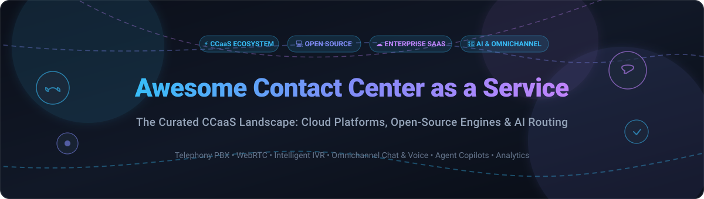
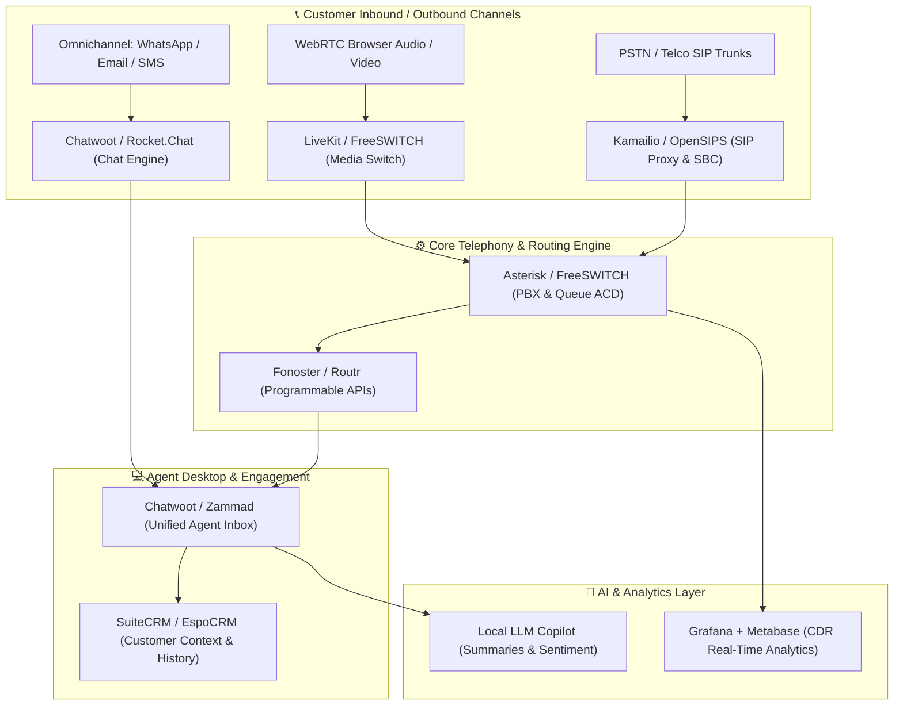

# 📞 Awesome Contact Center As A Service (CCaaS) 🚀

### A Curated Directory of Enterprise SaaS Solutions & Production Open-Source Telephony Platforms

  
  
  
  
  
  

  <strong>An authoritative, SEO-optimized compilation of Contact Center as a Service (CCaaS) technologies</strong> 
  Covering intelligent omnichannel routing (voice, SMS, WhatsApp, chat, email), AI agent copilots, WebRTC, SIP trunking, open-source PBX engines, IVR systems, and workforce engagement management (WEM).

---

## 📑 Table of Contents

- [📊 Sector Overview & Market Dynamics](#-sector-overview--market-dynamics)
- [☁️ SaaS/Hosted Platforms](#️-saashosted-platforms)
- [💻 Open-Source GitHub Projects](#-open-source-github-projects)
- [🏗️ Architectural Blueprint: Building a Custom CCaaS Stack](#️-architectural-blueprint-building-a-custom-ccaas-stack)
- [🤝 How to Contribute](#-how-to-contribute)
- [💖 Support & Sponsorship](#-support--sponsorship)
- [📈 Star History](#-star-history)
- [⚠️ Disclaimer](#️-disclaimer)

---

## 📊 Sector Overview & Market Dynamics

The global **Contact Center as a Service (CCaaS)** market represents one of the fastest-growing sectors in enterprise telecommunications, valued at approximately **$6.8B to $8.6B in 2026** and projected to surge past **$18B–$33B by the early 2030s** at an estimated **CAGR of 15%–22%**. Key structural tailwinds include widespread cloud migrations away from legacy on-premises telephony hardware, conversational AI copilot adoption, automated ticketing deflection, and unified agent workspaces.

From a market structure perspective, the CCaaS domain is **moderately concentrated** at the top tier: category champions such as **AWS (Amazon Connect)**, **Salesforce**, **NICE CXone**, and **Genesys** control large tranches of enterprise spend. Concurrently, a vibrant, **fragmented ecosystem** of regional CPaaS/CCaaS innovators and developer-first platforms fuels healthy competition across specialized industry verticals and localized telephony compliance standards.

---

## ☁️ SaaS/Hosted Platforms

The following matrix compares category-leading proprietary and cloud CCaaS offerings, ordered in descending order by **company market capitalization / enterprise valuation**:

| Platform | Company Valuation / Revenue | Starting Pricing | Free Tier / Trial Limits | Description & Capabilities |
| :--- | :--- | :--- | :--- | :--- |
| **[AWS Amazon Connect](https://aws.amazon.com/connect/)** | ~$2.8T market cap (Amazon) / ~$1B+ ARR | $0.018/min inbound + $0.004/min service usage ($0.01/chat message) | 12-Month Free Tier: 90 min/mo service usage, 1 local DID number, 30 min/mo inbound DID, 30 min/mo outbound calls | Serverless, pay-as-you-go cloud contact center engine powered by Contact Lens AI, automated IVR, and extensive AWS native integrations. |
| **[Salesforce Contact Center](https://www.salesforce.com/)** | ~$200B+ market cap / ~$38B+ ARR | $75/user/month (Digital) or $125/user/month (Complete) | 30-Day Free Trial (Service Cloud trial environment; full feature evaluation without credit card) | Deeply unified CRM and CCaaS suite featuring Einstein AI / Agentforce, real-time call transcription, and omnichannel customer journey management. |
| **[Twilio Flex](https://www.twilio.com/flex)** | ~$45B+ market cap / ~$4.5B+ ARR | $1.00/active user hour or $150/named user/month | 5,000 free Active User Hours credit for new Flex projects (no expiration until paid plan selected; telephony usage billed separately) | Programmable cloud contact center application platform built on Twilio CPaaS APIs with extensible React-based agent UI and serverless hooks. |
| **[Talkdesk](https://www.talkdesk.com/)** | ~$10B valuation (private) / ~$300M+ ARR | $85/user/month (Digital Essentials) or $105/user/month (Voice Essentials) | 15-Day Free Trial (via Talkdesk Express: up to 10 users, includes $100 pre-loaded telecom credits) | AI-powered enterprise contact center platform featuring Copilot agent assistance, intelligent routing, and industry-tailored clouds. |
| **[NICE CXone](https://www.nice.com/)** | ~$7B market cap / ~$2.8B+ ARR | $110/agent/month (Omnichannel Suite) | No free trial; guided sandbox / proof-of-concept available upon request via sales consultation | Comprehensive enterprise CCaaS platform with Enlighten AI agent assist, omnichannel journey orchestration, workforce management (WFM), and analytics. |
| **[Vonage Contact Center](https://www.vonage.com/)** | ~$6.2B (acquired by Ericsson) / ~$1.4B+ ARR | $69/agent/month (starting tier quote estimate) | No free trial for VCC platform (communications API trial available with 5 verified numbers & demo watermark credits) | Scalable contact center with omnichannel routing, AI conversational virtual assistant, and deep native Salesforce and CRM workflows. |
| **[Genesys Cloud CX](https://www.genesys.com/)** | ~$3B ARR (private valuation) | $75/user/month (CX 1 Voice) or $115/user/month (CX 2 Omnichannel) | 30-Day Free Trial (GCXNow trial capped at 10 concurrent configured users, outbound restrictions, max 10 min/call) | Industry-standard omnichannel contact center engine delivering AI forecasting, journey management, workforce engagement (WEM), and voice routing. |
| **[Five9](https://www.five9.com/)** | ~$2.5B market cap / ~$1.2B ARR | $119/user/month (Digital) or $159/user/month (Core Voice + Digital) | No free trial; custom proof-of-concept evaluation and guided product sandbox provided via sales | Cloud contact center with intelligent omnichannel routing, AI Agent Assist, Intelligent Virtual Agents (IVA), and robust CRM integrations. |
| **[Dialpad Ai Contact Center](https://www.dialpad.com/)** | ~$2.2B valuation (private) / ~$300M+ ARR | $80/user/month (Essentials) or $115/user/month (Advanced) | 14-Day Free Trial (includes core AI agent features, transcription, IVR call queues, and live coaching) | Modern AI-centric CCaaS platform delivering real-time transcription, automated customer sentiment scoring, and omnichannel queue routing. |
| **[8x8 Contact Center](https://www.8x8.com/)** | ~$300M market cap / ~$735M ARR | $85/user/month (X6 Voice) or $110/user/month (X7 Omnichannel) | No free trial for Contact Center (30-day trial available only on 8x8 Express business phone tier; demo on request) | Unified CCaaS and UCaaS communication platform featuring supervisor monitoring, omnichannel routing, and integrated voice analytics. |

---

## 💻 Open-Source GitHub Projects

Explore battle-tested open-source repositories for self-hosting, carrier-grade SIP routing, programmable voice engines, and modern omnichannel agent workspaces. **Sorted by GitHub stargazers count (descending):**

1. **[Rocket.Chat](https://github.com/RocketChat/Rocket.Chat)**   
   Enterprise open-source team communications and customer service messaging hub (MIT). Features omnichannel live chat widgets, WhatsApp, Facebook Messenger, and Instagram bridges, team routing, and agent queue management.

2. **[Novu](https://github.com/novuhq/novu)**   
   Open-source notification and customer communication infrastructure (MIT). Orchestrates multi-channel delivery across SMS, email, in-app notifications, and chat triggers for automated contact center outbound alerts and ticket updates.

3. **[Chatwoot](https://github.com/chatwoot/chatwoot)**   
   Modern open-source omnichannel customer engagement platform (MIT). Delivers agent shared inboxes, website live chat, email ticketing, WhatsApp/Telegram/SMS integrations, auto-assignment rules, and CRM connectivity.

4. **[Jitsi Meet](https://github.com/jitsi/jitsi-meet)**   
   Fully encrypted, 100% open-source video conferencing solution (Apache-2.0). Ideal for integrating high-definition video kiosks, screen-sharing escalation, and telehealth visual interactions directly into contact center agent desktops.

5. **[LiveKit](https://github.com/livekit/livekit)**   
   End-to-end WebRTC stack and real-time audio/video platform (Apache-2.0). Powering next-gen conversational AI voice agents, sub-second latency telephony streams, and ultra-scalable browser-based agent audio channels.

6. **[Fonoster](https://github.com/fonoster/fonoster)**   
   The open-source alternative to Twilio (MIT). Provides programmable voice, SMS messaging, and SIP trunking with modern Node.js/TypeScript SDKs, REST APIs, and microservice deployment options.

7. **[Papercups](https://github.com/papercups-io/papercups)**   
   Open-source customer messaging platform (MIT) built in Elixir and React. Features embeddable chat widgets, Slack conversation syncing, agent assignments, and customer session tracking.

8. **[Zammad](https://github.com/zammad/zammad)**   
   Web-based, open-source customer support and ticketing system (AGPL-3.0). Supports omnichannel communication across email, chat, Telegram, and native CTI telephony integrations with Asterisk and FreeSWITCH.

9. **[SuiteCRM](https://github.com/salesagility/SuiteCRM)**   
   Enterprise open-source CRM (AGPL-3.0) with robust customer service case management, customer history timelines, and Computer Telephony Integration (CTI) modules for contact center representatives.

10. **[FreeSWITCH](https://github.com/signalwire/freeswitch)**   
    High-performance, carrier-grade open-source communications engine (MPL-1.1). Handles complex voice, WebRTC, SIP, interactive voice response (IVR), video conferencing, and high-concurrency call switching.

11. **[Erxes](https://github.com/erxes/erxes)**   
    Open-source experience operating system (AGPL-3.0) unifying CRM, marketing automation, omnichannel shared inboxes, and help desk ticket management.

12. **[Asterisk](https://github.com/asterisk/asterisk)**   
    The legendary open-source PBX and telephony toolkit (GPL-2.0). Provides complete call queue distribution (ACD), voicemail, conferencing, IVR scripting, and the Asterisk REST Interface (ARI) for custom CCaaS platforms.

13. **[EspoCRM](https://github.com/espocrm/espocrm)**   
    Lightweight, fast open-source CRM (GPL-3.0) providing customer support ticket workflows, omnichannel communications logging, and VoIP telephony integration (Twilio, Asterisk, and Starface).

14. **[Kamailio](https://github.com/kamailio/kamailio)**   
    Ultra-fast open-source SIP server (GPL-2.0) capable of handling millions of call setups daily. Used by global telecom operators for SIP load balancing, VoIP routing, NAT traversal, and DDoS mitigation.

15. **[Live Helper Chat](https://github.com/LiveHelperChat/livehelperchat)**   
    Multi-platform open-source live support chat application (Apache-2.0). Supports speech recognition, automated bot workflows, file transfer, and department routing for contact centers.

16. **[Routr](https://github.com/fonoster/routr)**   
    Cloud-native, lightweight SIP proxy, location server, and registrar (MIT) written in Node.js and Go. Designed for Kubernetes-driven voice routing, edge WebRTC peering, and multi-tenant telephony.

17. **[OpenSIPS](https://github.com/OpenSIPS/opensips)**   
    Multi-functional, enterprise-scale open-source SIP proxy and application server (GPL-2.0). Delivers high-throughput voice load balancing, presence engine, and advanced session management.

18. **[FusionPBX](https://github.com/fusionpbx/fusionpbx)**   
    Open-source GUI management platform (MPL-1.1) for FreeSWITCH. Provides multi-tenant contact center administration, inbound/outbound queues, IVR menu designers, call detail records (CDR), and agent status dashboards.

19. **[Wazo Platform](https://github.com/wazo-platform/wazo-platform)**   
    API-first programmable telecommunications platform (GPL-3.0) built on Asterisk. Provides microservices and REST APIs to build bespoke contact center applications, WebRTC clients, and unified communications.

20. **[VICIdial](https://github.com/vicidial/vicidial)**   
    Extensively used open-source predictive dialer and contact center software suite (AGPL-2.0). Features blended inbound/outbound calling, campaign managers, agent script prompts, and regulatory compliance logging.

21. **[FreePBX Framework](https://github.com/FreePBX/framework)**   
    The graphical administration framework (GPL-2.0) powering FreePBX and Asterisk. Features queue penalty strategies, call recording archives, ring groups, and time condition routing.

---

## 🏗️ Architectural Blueprint: Building a Custom CCaaS Stack

For engineering teams aiming to build a sovereign, cost-effective, self-hosted contact center platform:

- **SIP Routing & Edge Security**: [Kamailio](https://github.com/kamailio/kamailio) or [OpenSIPS](https://github.com/OpenSIPS/opensips) for carrier-grade SIP termination and DDoS protection.
- **Audio & Switching Engine**: [FreeSWITCH](https://github.com/signalwire/freeswitch) or [Asterisk](https://github.com/asterisk/asterisk) for ACD queues, recording, and IVR logic.
- **WebRTC & Real-time Media**: [LiveKit](https://github.com/livekit/livekit) for browser-based voice streams and AI audio agents.
- **Unified Agent Desktop**: [Chatwoot](https://github.com/chatwoot/chatwoot) or [Rocket.Chat](https://github.com/RocketChat/Rocket.Chat) for omnichannel message aggregation and live customer chat.
- **Ticketing & Case History**: [Zammad](https://github.com/zammad/zammad) or [SuiteCRM](https://github.com/salesagility/SuiteCRM) for SLA tracking and agent notes.
- **Metrics & Reporting**: Grafana + ClickHouse/PostgreSQL for real-time contact center KPI monitoring.

---

## 🤝 How to Contribute

Contributions from telecom engineers, product managers, and developers are warmly welcomed! 🌟

1. 🍴 **Fork the repository** on GitHub.
2. 🌿 **Create a descriptive feature branch** (`git checkout -b add-my-ccaas-project`).
3. 📝 **Add or update entries** in `README.md` keeping the Markdown formatting and tabular structure clean.
4. 🔍 **Verify links and details**: Ensure repository URLs, Stars_Badges, and official links are correct.
5. 🚀 **Submit a Pull Request** with a brief summary of the project and why it belongs in the CCaaS ecosystem.

---

## 💖 Support & Sponsorship

If this curated repository saved you time, helped your company design an omnichannel contact center, or provided valuable architectural insights, please consider supporting the project:

- ⭐ **Star this repository** to help others discover it.
- 🍴 **Fork and share** with your telecom, DevOps, and customer experience peers.
- ☕ **Sponsor the Maintainer**: Buy a coffee and support continued open-source curation on the [GitHub Sponsors Dashboard](https://github.com/sponsors/ishandutta2007).

---

## 📈 Star History

---

## ⚠️ Disclaimer

- This list is a **community-curated index** compiled for informational and technical comparison purposes. It does not constitute a commercial endorsement.
- Contact center deployments processing personal customer information must strictly adhere to regulatory frameworks including **GDPR**, **HIPAA**, **TCPA**, and **PCI-DSS**.
- Production deployments of self-hosted open-source telephony systems require proper network hardening, firewall filtering, SIP trunk access controls, and ongoing TLS/SRTP encryption.

---

**Built with ❤️ for contact center managers, telecom engineers, CX leaders, and software architects worldwide.**

